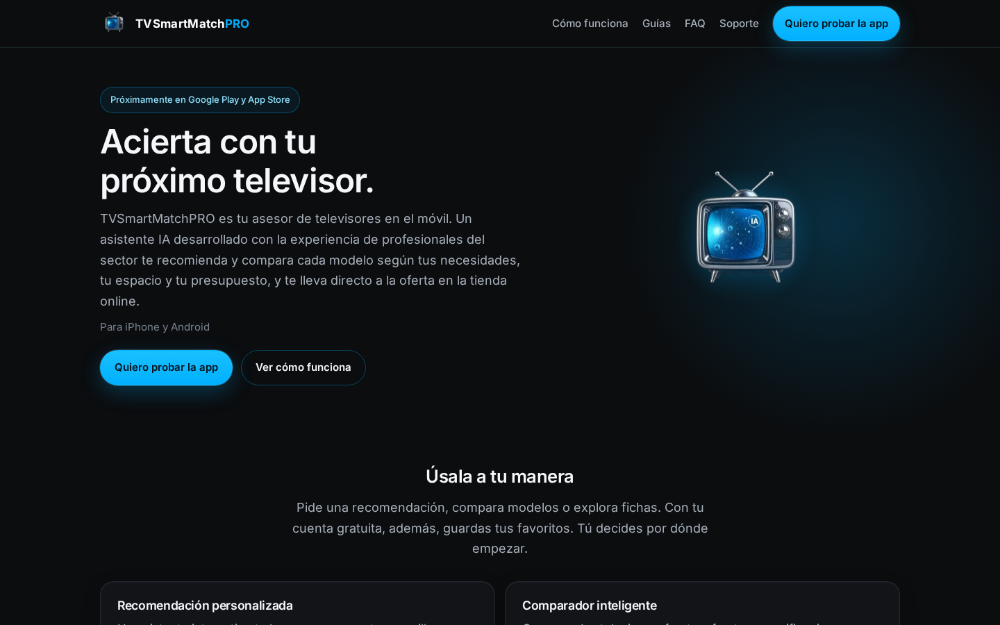

# TVSmartMatchPRO · Caso de estudio de la web

Caso práctico sobre la web oficial de **TVSmartMatchPRO**, [tvsmartmatch.com](https://tvsmartmatch.com): cómo pasó de una SPA en React a un sitio estático en Astro y qué decisiones se tomaron sobre rendimiento, SEO, accesibilidad, privacidad y emails transaccionales.

> **El código fuente es privado.** Este repositorio solo reúne la documentación del proyecto y algunas capturas. Las cifras que aparecen se pueden contrastar con el código y los informes del repositorio privado; donde un dato tiene limitaciones, se indican.

<!-- HUECO: captura de la portada en escritorio (1440 px) -->

---

## Contenido

1. [El producto](#el-producto)
2. [Punto de partida](#punto-de-partida)
3. [Por qué Astro](#por-qué-astro)
4. [Cronología de la migración](#cronología-de-la-migración)
5. [Decisiones técnicas](#decisiones-técnicas)
6. [Stack](#stack)
7. [Resultados verificables](#resultados-verificables)
8. [Capturas](#capturas)
9. [Lo aprendido](#lo-aprendido)
10. [Contacto](#contacto)

---

## El producto

TVSmartMatchPRO es una app móvil para iPhone y Android que ayuda a elegir televisor: recomienda modelos según la estancia, el uso y el presupuesto, los compara, muestra fichas técnicas claras y enlaza a la oferta en la tienda online. La app está en fase de pruebas y todavía no se ha publicado en las tiendas.

La web cumple cuatro funciones:

- presentar el producto y su funcionamiento;
- publicar guías de compra;
- recoger solicitudes para las versiones de prueba;
- alojar las páginas legales, de soporte y de gestión de cuenta que exigen Google Play y App Store.

---

## Punto de partida

Desde septiembre de 2025 hasta el 1 de octubre de 2026 la web fue una SPA construida con:

- React 19.1 y React Router 7
- Vite 7
- Tailwind CSS 3.4
- Framer Motion 12
- Netlify Functions para los formularios

Funcionaba, pero arrastraba limitaciones propias de una SPA aplicada a un sitio de contenido:

- el HTML de cada ruta dependía de JavaScript en el navegador;
- el bundle cargaba un framework completo para páginas casi estáticas;
- los metadatos se inyectaban desde un componente React en el cliente y el `sitemap.xml` se mantenía a mano;
- los textos legales vivían dentro de componentes TSX, lo que dificultaba revisarlos.

Además, el producto había cambiado: la web debía dejar de anunciar una beta y pasar a presentar la app y gestionar testers.

---

## Por qué Astro

- **HTML generado en la compilación.** Cada ruta se sirve como un archivo HTML completo, sin depender de JavaScript para mostrarse.
- **Sin framework en el navegador.** El JavaScript de cliente se reduce a pequeños scripts propios: menú, formularios, consentimiento y animaciones de aparición.
- **Contenido como datos.** Las guías son archivos Markdown validados con un esquema, lo que facilita añadir nuevas sin tocar componentes.
- **Encaje con la infraestructura existente.** Netlify y sus funciones se mantuvieron, así que el cambio afectó al front y no a la operativa.

---

## Cronología de la migración

Fechas reales tomadas del historial de Git (hora peninsular española).

| Fecha | Hito |
|---|---|
| 1 oct 2026 (noche) | Rama de copia con la versión React y commit «migrar el proyecto a Astro y retirar la SPA React». Primera versión de la web nueva con marca, páginas legales, guías y formularios, y primera ronda de ajustes (fase C). |
| 2 oct 2026 (mañana) | Revisión en fases sucesivas (D a G3). En cada una: correcciones de diseño, textos y accesibilidad, capturas en varios anchos de pantalla y una medición con Lighthouse. |
| 2 oct 2026 (tarde) | Doble opt-in de Brevo para testers y plantillas nuevas para los emails de contacto. Publicación de la web nueva en producción (PR #1). |
| 2 oct 2026 (noche) | Paquete SEO-1 (PR #2): datos estructurados, redirección del sitemap antiguo, ajuste de la política de seguridad para Analytics, favicons definitivos y consentimiento denegado por defecto. |
| 3 oct 2026 | Página de confirmación de cuenta para la app (PR #3). |

Los tres bloques llegaron a producción mediante pull request, revisados antes en una vista previa de despliegue.

---

## Decisiones técnicas

### Rendimiento

- Salida 100 % estática y CSS incrustado en el HTML para evitar peticiones bloqueantes.
- Tipografía Inter alojada en el propio dominio (woff2) con *preload* de los pesos principales; no se usa ningún servicio externo de fuentes.
- Logos en WebP con `srcset` y dimensiones explícitas.
- Caché de un año para logos y fuentes.
- Las animaciones de aparición respetan `prefers-reduced-motion` y el contenido es visible aunque el JavaScript no se ejecute.

### SEO

- Título, descripción y URL canónica por página; Open Graph y Twitter Card con imagen propia.
- Datos estructurados JSON-LD: `Organization` y `WebSite` en todo el sitio, `BlogPosting` y `BreadcrumbList` en las guías, `FAQPage` en las preguntas frecuentes.
- Sitemap generado automáticamente; las páginas de confirmación llevan `noindex` y quedan fuera de él.
- Redirecciones 301 desde las URLs de la web anterior (alias legales en español, `/beta`, `/sitemap.xml`) para no perder enlaces.
- Sitemap dado de alta en Google Search Console, en estado «Correcto» con las 14 URLs descubiertas.

### Accesibilidad

- Enlace «Saltar al contenido» y estructura semántica (`header`, `main`, `nav`, `article`).
- Menú móvil con `aria-expanded`, etiqueta que cambia entre abrir y cerrar, cierre con Escape y retorno del foco al botón.
- Formularios con etiquetas visibles y mensajes de estado anunciados por lectores de pantalla (`aria-live`).
- Barras de puntuación accesibles, acompañadas de una leyenda que explica cada nivel.

### Privacidad y consentimiento

- Banner por capas siguiendo la guía de la AEPD: aceptar, rechazar o configurar desde el primer nivel.
- Google Analytics 4 no se carga hasta que el usuario acepta la analítica. El consentimiento parte denegado y los permisos publicitarios nunca se conceden.
- Al retirar el consentimiento se eliminan las cookies de Analytics, también en los dominios padre, y se recarga la página.
- La elección caduca a los 12 meses y se vuelve a preguntar.
- Los eventos de conversión no llevan datos personales (solo el nombre del formulario y, en el de testers, la plataforma).
- Se retiró Microsoft Clarity, presente en la versión anterior: Google Analytics queda como única herramienta de medición.

### Emails transaccionales

- **Testers:** doble opt-in con Brevo. El usuario confirma desde su correo y solo entonces queda en la lista; después aterriza en una página de confirmación propia.
- **Soporte:** cada mensaje genera una referencia única, un acuse de recibo para el usuario y un aviso interno, con las direcciones de respuesta cruzadas para contestar directamente.
- **App:** el enlace de confirmación de cuenta de la app abre una página de la web que distingue entre cuenta activada y enlace caducado, y limpia los parámetros de la URL.
- Las claves de Brevo solo existen en el servidor (funciones), nunca en el navegador.

### Seguridad de los formularios

- Política de seguridad de contenidos (CSP) restrictiva y cabeceras `X-Frame-Options`, `nosniff`, `Referrer-Policy` y `Permissions-Policy`.
- Las funciones solo aceptan peticiones desde los dominios del proyecto.
- Filtro antibots sin captcha: campo trampa oculto y tiempo mínimo de 3 segundos antes de enviar.
- Validación y límites de longitud en el servidor; los registros guardan códigos de estado, no datos de los usuarios.

---

## Stack

### Web (este caso de estudio)

| Área | Tecnología |
|---|---|
| Generador | Astro 5 (salida estática) |
| Estilos | CSS propio con *design tokens* |
| Contenido | Astro Content Collections (Markdown + esquema Zod) |
| Backend | Netlify Functions (Node) |
| Email | Brevo |
| Analítica | Google Analytics 4 con consentimiento previo |
| SEO | `@astrojs/sitemap`, JSON-LD, Google Search Console |
| Calidad | TypeScript, Playwright, Lighthouse |
| Hosting | Netlify |

### App (contexto)

| Área | Tecnología |
|---|---|
| Móvil | Expo y React Native con TypeScript, Expo Router |
| Datos y autenticación | Supabase (PostgreSQL y Auth) |
| Estado y formularios | TanStack Query, Zustand, React Hook Form + Zod |
| Calidad | Pruebas automatizadas con Jest e integración continua en GitHub Actions |
| Catálogo | Proceso automatizado que mantiene actualizados modelos y precios |

---

## Resultados verificables

- **Migración realizada entre el 1 y el 3 de octubre de 2026**, en tres pull requests, con la versión anterior preservada en una rama de copia.
- **14 URLs en el sitemap:** 10 páginas y 4 guías de compra (Hz reales frente a Hz de marketing, OLED o Mini LED, tamaño según distancia y televisor para gaming).
- **Lighthouse** (móvil, mediana de 3 pasadas, medido el 2 de octubre de 2026 en la vista previa de despliegue, antes de SEO-1):

  | Página | Rendimiento | Accesibilidad |
  |---|---|---|
  | Portada | 91 | 100 |
  | Guía «tamaño según distancia» | 99 | 100 |

  Solo se midieron esas dos categorías. No hay una medición equivalente de la versión React, así que no se presenta como comparativa.
- **Consentimiento probado** con navegador limpio: sin aceptar no se carga Analytics; al rechazar no queda ninguna cookie `_ga`; las preferencias de la versión anterior se descartan y se vuelve a preguntar.

---

## Capturas

Pendientes de añadir:

| Archivo | Contenido |
|---|---|
| `assets/portada.png` | Portada en escritorio |
| `assets/portada-movil.png` | Portada en móvil (390 px) |
| `assets/banner-cookies.png` | Banner de consentimiento por capas |
| `assets/preferencias-cookies.png` | Diálogo de preferencias |
| `assets/guia.png` | Una guía de compra |
| `assets/formulario-testers.png` | Formulario de solicitud para las versiones de prueba |

---

## Lo aprendido

- **Medir en cada iteración.** Hacer capturas y pasar Lighthouse al cerrar cada fase permitió detectar a tiempo desbordes horizontales en móvil o botones del banner que no respondían.
- **El consentimiento hay que probarlo, no suponerlo.** Las cookies de Analytics pueden quedar en el dominio padre; borrarlas solo en el host actual no basta.
- **Conocer el ciclo de vida del proveedor.** En el doble opt-in de Brevo, el contacto no existe hasta que confirma, así que algunos atributos deben guardarse en un paso posterior.
- **Los textos también son producto.** La web solo promete lo que la app hace hoy; cada afirmación se revisó contra el comportamiento real.
- **La documentación envejece.** Al migrar, los documentos de la etapa React dejaron de describir el código; por eso este caso de estudio solo cita datos que pueden comprobarse.
- **Pendiente:** repetir Lighthouse en producción tras SEO-1 y reducir el desplazamiento de diseño de la portada (CLS de 0,106 en la pasada mediana, ligeramente por encima del umbral recomendado de 0,1).

---

## Contacto

- Web: [tvsmartmatch.com](https://tvsmartmatch.com)
- Email: [info@tvsmartmatch.com](mailto:info@tvsmartmatch.com)
- Autor: David Pérez · [LinkedIn](https://www.linkedin.com/in/perezrodriguezdavid)

© TVSmartMatchPRO. Documentación publicada con fines de portfolio; el código y los datos del proyecto no se distribuyen.
